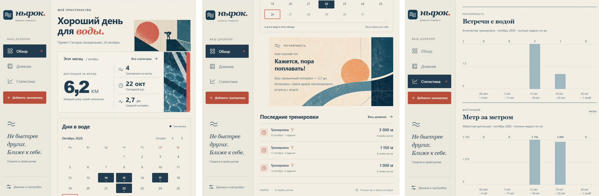
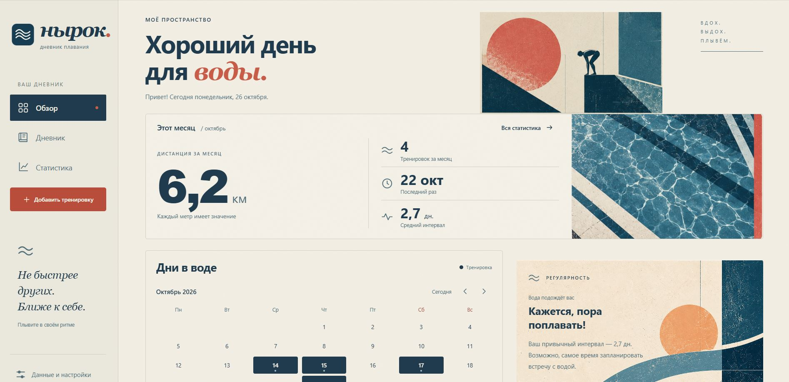
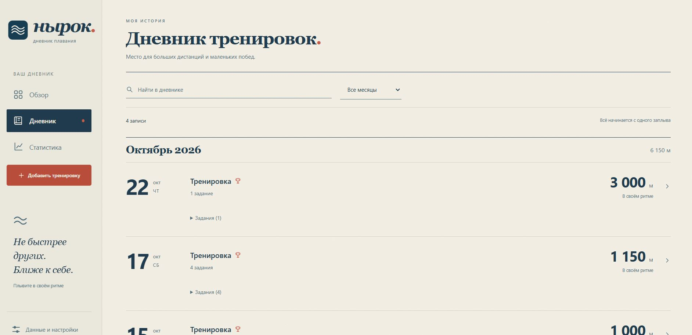
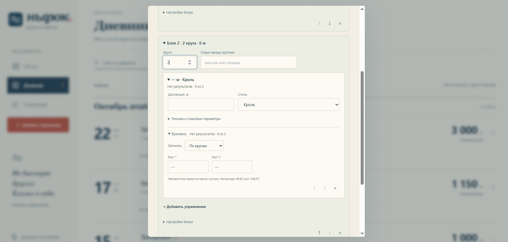
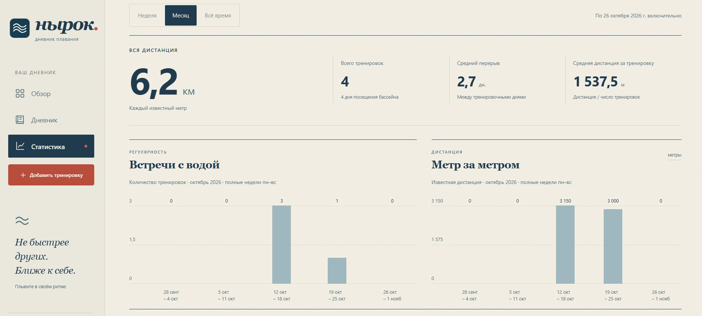
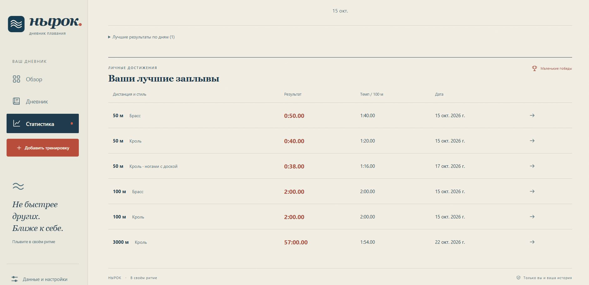

# Nyrok — Personal Swimming Journal

Nyrok (Нырок) is a personal swimming workout journal built as a lightweight, local-first web application.

It helps swimmers keep a history of their pool sessions, organize workout routines, record individual lap times and follow their progress over time.

Rather than focusing on competition, calories or daily streaks, Nyrok is designed around a simpler idea: **swim at your own pace and enjoy seeing how far you've come.**

The application runs locally, without accounts, cloud services or external JavaScript libraries. Workout history is stored in the browser, with JSON import and export available for backups.



---

## 🛠️ Tech Stack

- JavaScript (ES Modules)
- HTML5
- CSS3
- Node.js
- Browser localStorage
- Node.js built-in test runner

No frontend frameworks or third-party JavaScript libraries are required.

---

## 🚀 Features

- Personal swimming diary with workout history
- Calendar showing swimming days
- Custom workout builder with blocks, exercises and repeated rounds
- Swimming styles and technique variations
- Planned intervals, rest periods and actual lap times
- Quick result editing directly from the diary
- Workout copying
- Distance, frequency and pace statistics
- Personal records for individual distances and swimming techniques
- Adaptive desktop and mobile interface
- Local data storage with JSON backup and restore
- No registration or internet connection required for everyday use

---

## 💡 Main Functionality

### 🌊 Swimming Overview

The home screen brings together your recent swimming activity, monthly distance, workout frequency and a calendar of pool visits.

Nyrok also uses your usual interval between sessions to display gentle, personalized reminders — without demanding that you swim every day.



### 📖 Training Diary

Browse your swimming history, search for previous workouts and review the details of each session.

Every workout can contain multiple blocks and exercises, with distances, swimming styles, technique notes and recorded results.

Results can be updated directly from the diary without opening the full workout editor.



### 🏊 Workout Builder

Create structured swimming sessions using blocks and repeated rounds.

Each exercise can have its own distance, swimming style, technique, planned time and rest interval.

Record individual results for each round or save only your best time. Workouts can also be copied from previous sessions to reuse their structure.



### 📊 Statistics & Personal Records

Explore your swimming progress through workout frequency, distance and pace charts.

Switch between weekly, monthly and all-time statistics. Track your best results for specific distances, swimming styles and techniques.

The pace chart uses the best recorded time for each training day, making it easier to follow progress over time.




---

## 🎨 Interface

Nyrok uses an editorial-inspired visual style with warm paper tones, deep blue typography, vintage swimming illustrations and textured geometric artwork.

The interface is designed to feel more like a personal swimming notebook than a conventional fitness dashboard.

The responsive layout supports both desktop and mobile screens.

---

## 📦 Installation

Requires **Node.js 20 or newer**.

Clone the repository:

```bash
git clone https://github.com/egor-no/dive.git
cd dive
```

Start the local server:

```bash
node scripts/server.mjs
```

Open **http://localhost:4173** in your browser.

On Windows, you can also launch the application using `start.bat`.

The application stores data in your browser's localStorage. Use the same browser profile and address to access your existing workout history.

---

## ⚙️ Development

Run automated tests:

```bash
node --test
```

Build the static application:

```bash
node scripts/build.mjs
```

Preview the built application:

```bash
node scripts/server.mjs --dist
```

For additional information about workout calculations, data storage, JSON import/export and backward compatibility, see [Technical Documentation](docs/TECHNICAL.md).

---

## 💾 Data & Privacy

Nyrok works locally and does not require registration or a cloud account.

Workout data is stored in the browser using localStorage and is not sent to an external server.

You can export your diary as a JSON file and restore it later through the import feature.

**Important:** Clearing your browser's site data may permanently delete your workout history. Regular JSON backups are recommended.
